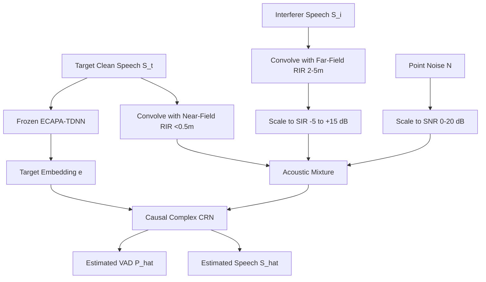

# 02. Synthetic Training & Emotional Speech Robustness

This document details the data engineering, simulation pipelines, acoustic room modeling, and loss functions required to train the causal TSE model.

---

## 1. The Core Training Challenge: Distribution Shift

Academic TSE toolkits (e.g., WeSep recipes using LibriSpeech / Libri2Mix) yield near-perfect metric scores on calm, professional audiobook narrations. However, they fail in production live gaming and call environments due to two primary distribution shifts:

1. **Vocal Dynamic Range ("Gamer Scream"):**
   - Whispering: Unvoiced glottal excitation, lack of clear pitch ($F_0$), high spectral tilt.
   - Shouting/Laughter: $F_0$ shifts dramatically ($>400\text{ Hz}$), non-linear vocal tract distortion, mic clipping.
   - Standard academic models treat these fluctuations as an unknown speaker and mute the user.
2. **Room Reverberation & Proximity Effect:**
   - Target speaker sits $2\text{--}10\text{ cm}$ from the mic: high direct-to-reverberant ratio (DRR), prominent low-frequency bass boost (proximity effect).
   - Interfering speaker sits $1.5\text{--}5.0\text{ meters}$ away: high reverberant energy, lower DRR, diffuse phase profiles.

---

## 2. Dataset Composition

To ensure generalization across gaming, casual voice calls, and noisy environments, the training corpus blends multiple data sources:

| Dataset Category | Sources | Purpose | Mixture Share |
| :--- | :--- | :--- | :--- |
| **Neutral Clean Speech** | LibriSpeech (`train-clean-360`), VCTK | Foundational phonetic diversity and clean formant transitions | 35% |
| **Emotional Speech** | ESD (Emotional Speech Database), CREMA-D | Shouting, whispering, excitement, rage, fear | 40% |
| **Noises & Impulses** | DEMAND, DNS Challenge Noise partition | Stationary (fans, HVAC) and non-stationary (mechanical keyboards, mouse clicks) | 15% |
| **Room Acoustics** | OpenSLR RIRs, DNS Challenge Simulated RIRs | Simulating real room geometry, reflections, and distances | 10% |

---

## 3. Dynamic On-The-Fly Mixing Pipeline

Audio scenes are synthesized on-the-fly during training batches to prevent network memorization:

### Mixing Recipe Steps:
1. **Target Selection ($S_t$):** Draw a 4-second chunk from speaker $A$. Select an enrollment clip (distinct 4-second chunk) from the same speaker $A$ to feed the frozen speaker encoder.
2. **Interferer Selection ($S_i$):** Draw a clip from speaker $B \neq A$. Sample the Signal-to-Interference Ratio (SIR) uniformly:
   $$\text{SIR} \sim \mathcal{U}(-5\text{ dB}, +15\text{ dB})$$
3. **Additive Noise ($N$):** Sample environmental noise and compute root-mean-square (RMS) level to match target Signal-to-Noise Ratio (SNR):
   $$\text{SNR} \sim \mathcal{U}(0\text{ dB}, 20\text{ dB})$$
4. **Room Impulse Convolution:**
   - Target $S_t$: convolved with near-field RIR ($d \le 0.4\text{ m}$, reverberation time $T_{60} < 0.2\text{ s}$).
   - Interferer $S_i$: convolved with diffuse far-field RIR ($d \in [1.5\text{ m}, 4.0\text{ m}]$, $T_{60} \in [0.2\text{ s}, 0.6\text{ s}]$).
5. **Combined Mixture ($Y$):**
   $$Y = (S_t * h_{\text{near}}) + \alpha \cdot (S_i * h_{\text{far}}) + \beta \cdot N$$

---

## 4. Multi-Task Objective Loss Functions

The model is optimized using a composite loss function targeting time-domain separation, spectral fidelity, and voice activity accuracy:

$$\mathcal{L}_{\text{total}} = \mathcal{L}_{\text{SI-SDR}}(s_t, \hat{s}_t) + \lambda_{\text{spec}} \mathcal{L}_{\text{complex}}(S_t, \hat{S}_t) + \lambda_{\text{vad}} \mathcal{L}_{\text{BCE}}(y_{\text{vad}}, \hat{y}_{\text{vad}})$$

### 4.1 Scale-Invariant Signal-to-Distortion Ratio (SI-SDR)
SI-SDR provides scale-invariant time-domain fidelity:

$$\alpha = \frac{\langle \hat{s}, s \rangle}{\|s\|_2^2}, \quad e_{\text{target}} = \alpha s, \quad e_{\text{res}} = \hat{s} - e_{\text{target}}$$

$$\mathcal{L}_{\text{SI-SDR}} = -10 \log_{10}\left(\frac{\|e_{\text{target}}\|_2^2}{\|e_{\text{res}}\|_2^2 + \epsilon}\right)$$

### 4.2 Complex Spectral Loss
Enforces both magnitude envelope and phase accuracy:

$$\mathcal{L}_{\text{complex}} = \frac{1}{T \cdot F} \sum_{m, k} \left( \left| |S(m, k)| - |\hat{S}(m, k)| \right| + \left| S_r(m, k) - \hat{S}_r(m, k) \right| + \left| S_i(m, k) - \hat{S}_i(m, k) \right| \right)$$

### 4.3 Personal VAD Binary Cross-Entropy
Given ground truth binary target speech activity $y_m \in \{0, 1\}$ for frame $m$:

$$\mathcal{L}_{\text{BCE}} = -\frac{1}{M} \sum_{m=1}^{M} \left[ y_m \log(\hat{y}_m) + (1 - y_m) \log(1 - \hat{y}_m) \right]$$

Recommended hyperparameter weights: $\lambda_{\text{spec}} = 0.5$, $\lambda_{\text{vad}} = 0.1$.
