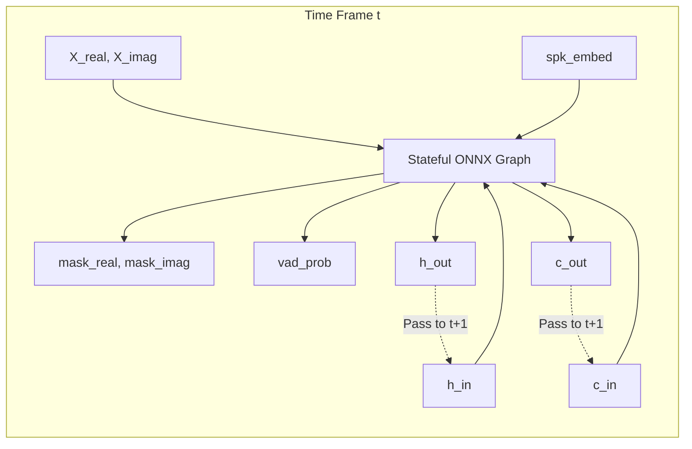

# 03. Streaming ONNX Export & Runtime Profiling

This document outlines the procedure for converting the causal PyTorch model into an optimized, stateful ONNX computational graph suitable for real-time inference.

---

## 1. Stateful Recurrent Graph Design

In standard PyTorch inference, recurrent layers (LSTM or GRU) can process an entire sequence at once. However, in a 10ms real-time audio loop, recalculating from the beginning of the stream causes $O(T^2)$ computational explosion.

To maintain strictly $O(1)$ constant time per frame, the ONNX model must accept and emit recurrent hidden states on every step.



---

## 2. ONNX Tensor Contract

### Input Tensors
| Tensor Name | Shape | Data Type | Description |
| :--- | :--- | :--- | :--- |
| `input_real` | `[1, 1, 1, 257]` | `float32` | Real STFT spectrum for the current 10ms frame |
| `input_imag` | `[1, 1, 1, 257]` | `float32` | Imaginary STFT spectrum for the current 10ms frame |
| `spk_embed` | `[1, 256]` | `float32` | Enrolled normalized target speaker vector |
| `h_in` | `[num_layers, 1, hidden_dim]` | `float32` | Recurrent hidden state from previous frame |
| `c_in` | `[num_layers, 1, hidden_dim]` | `float32` | Recurrent cell state from previous frame |

### Output Tensors
| Tensor Name | Shape | Data Type | Description |
| :--- | :--- | :--- | :--- |
| `mask_real` | `[1, 1, 1, 257]` | `float32` | Real component of cIRM |
| `mask_imag` | `[1, 1, 1, 257]` | `float32` | Imaginary component of cIRM |
| `vad_prob` | `[1, 1]` | `float32` | Target speech presence probability $[0.0, 1.0]$ |
| `h_out` | `[num_layers, 1, hidden_dim]` | `float32` | Updated hidden state for frame $t+1$ |
| `c_out` | `[num_layers, 1, hidden_dim]` | `float32` | Updated cell state for frame $t+1$ |

---

## 3. PyTorch Export Wrapper Pattern

To export the model cleanly, encapsulate the streaming forward step in a specialized `torch.nn.Module`:

```python
import torch
import torch.nn as nn

class StreamingONNXWrapper(nn.Module):
    def __init__(self, core_model):
        super().__init__()
        self.core = core_model

    def forward(self, input_real, input_imag, spk_embed, h_in, c_in):
        # Pack complex spectrum into 2-channel representation [B, 2, 1, F]
        x = torch.cat([input_real, input_imag], dim=1)
        
        # Forward pass through encoder, FiLM bottleneck, and recurrent core
        mask_real, mask_imag, vad_prob, h_out, c_out = self.core.forward_frame(
            x, spk_embed, h_in, c_in
        )
        
        return mask_real, mask_imag, vad_prob, h_out, c_out

def export_model(model, output_path="model_streaming.onnx"):
    wrapper = StreamingONNXWrapper(model).eval()
    
    dummy_real = torch.randn(1, 1, 1, 257)
    dummy_imag = torch.randn(1, 1, 1, 257)
    dummy_embed = torch.randn(1, 256)
    dummy_h = torch.zeros(2, 1, 256)
    dummy_c = torch.zeros(2, 1, 256)
    
    torch.onnx.export(
        wrapper,
        (dummy_real, dummy_imag, dummy_embed, dummy_h, dummy_c),
        output_path,
        input_names=["input_real", "input_imag", "spk_embed", "h_in", "c_in"],
        output_names=["mask_real", "mask_imag", "vad_prob", "h_out", "c_out"],
        opset_version=17,
        do_constant_folding=True
    )
```

---

## 4. Verification of Equivalence

Before deploying to native runtimes, verify numerical consistency between PyTorch and ONNX Runtime:

```python
import onnxruntime as ort
import numpy as np

# 1. Run 100 sequential synthetic frames through PyTorch
# 2. Run identical frames through ONNX Runtime, propagating h_t and c_t
# 3. Assert max absolute error is negligible:
# np.max(np.abs(torch_mask - ort_mask)) < 1e-4
```

---

## 5. Execution Providers & Performance Targets

Target latency per 10ms frame: **$\le 2.5\text{ ms}$** (allows a $75\%$ safety headroom before buffer underruns occur).

| Platform / Provider | Target Quantization | Expected Frame Latency | Notes |
| :--- | :--- | :--- | :--- |
| **CPU (AVX2 / AVX-512)** | INT8 Dynamic Quantization | $1.8\text{--}2.4\text{ ms}$ | Lowest dependency footprint; runs across all x86/x64 systems. |
| **DirectML** | FP16 | $1.0\text{--}1.5\text{ ms}$ | Native on Windows; runs on AMD, Intel, and NVIDIA consumer GPUs. |
| **TensorRT / CUDA** | FP16 | $0.4\text{--}0.8\text{ ms}$ | Optimal for NVIDIA RTX systems; zero CPU utilization. |
| **OpenVINO** | INT8 / FP16 | $1.2\text{--}1.8\text{ ms}$ | Optimized for Intel Core / Core Ultra NPU & Iris Xe engines. |
