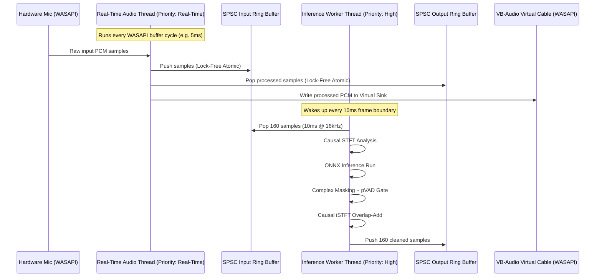

# 04. Audio Engine & Low-Latency Daemon

This document details the real-time audio pipeline, threading architecture, lock-free queue implementations, and routing strategies into virtual audio sinks.

---

## 1. The Real-Time Audio Golden Rules

An audio callback operates under hard real-time scheduling constraints. If an audio thread misses its deadline by even 1 millisecond, the operating system hardware buffer starves, producing an audible click, pop, or stutter (a buffer underrun).

To guarantee glitch-free operation, **Thread 1 (Audio Callback)** must adhere to four strict invariants:

1. **No Heap Allocations:** Never call `malloc`, `free`, `new`, `delete`, or allocate dynamic containers (`std::vector::push_back`). All scratch buffers are pre-allocated at initialization.
2. **No Mutex Locks:** Never lock an OS mutex (`std::mutex`, `CRITICAL_SECTION`, `pthread_mutex`). A low-priority thread holding the lock can cause unbounded priority inversion.
3. **No I/O Operations:** No file logging, console printing (`printf`, `std::cout`), socket communications, or disk writes.
4. **No Direct Inference:** Never execute model runs inside the audio callback.

---

## 2. Dual-Thread Architecture



---

## 3. Lock-Free SPSC Circular Buffer (Design Pattern)

A Single-Producer Single-Consumer (SPSC) ring buffer enables communication between Thread 1 and Thread 2 without locking:

```cpp
#include <atomic>
#include <cstddef>
#include <vector>

template <typename T, size_t Capacity>
class SPSCRingBuffer {
    static_assert((Capacity & (Capacity - 1)) == 0, "Capacity must be a power of 2");
private:
    T buffer[Capacity];
    alignas(64) std::atomic<size_t> head{0}; // Read index (Consumer)
    alignas(64) std::atomic<size_t> tail{0}; // Write index (Producer)

public:
    bool push(const T* items, size_t count) {
        const size_t current_tail = tail.load(std::memory_order_relaxed);
        const size_t current_head = head.load(std::memory_order_acquire);
        
        if (Capacity - (current_tail - current_head) < count) {
            return false; // Queue full
        }
        
        for (size_t i = 0; i < count; ++i) {
            buffer[(current_tail + i) & (Capacity - 1)] = items[i];
        }
        
        tail.store(current_tail + count, std::memory_order_release);
        return true;
    }

    bool pop(T* destination, size_t count) {
        const size_t current_head = head.load(std::memory_order_relaxed);
        const size_t current_tail = tail.load(std::memory_order_acquire);
        
        if (current_tail - current_head < count) {
            return false; // Not enough samples available
        }
        
        for (size_t i = 0; i < count; ++i) {
            destination[i] = buffer[(current_head + i) & (Capacity - 1)];
        }
        
        head.store(current_head + count, std::memory_order_release);
        return true;
    }
};
```

Key attributes:
- `alignas(64)` aligns atomics to separate CPU cache lines to prevent **false sharing** between core caches.
- Memory orders (`memory_order_acquire` / `memory_order_release`) enforce memory fence synchronization across processor architectures without heavy lock penalties.

---

## 4. Audio Routing & Windows WASAPI Integration

### 4.1 Device Enumeration & Binding
- **Input Device:** Physical microphone selected by the user via WASAPI Capture (`AUDCLNT_SHAREMODE_SHARED`).
- **Output Sink:** "CABLE Input (VB-Audio Virtual Cable)" via WASAPI Render (`AUDCLNT_SHAREMODE_SHARED`).
- Third-party chat apps (Discord, Zoom, Teams) select "CABLE Output (VB-Audio Virtual Cable)" as their input microphone.

### 4.2 Handling Sample Rate Mismatches
Microphones often default to $44.1\text{ kHz}$ or $48\text{ kHz}$, whereas the model operates at $16\text{ kHz}$.
- Resampling is handled using a polyphase FIR filter or a light sinc resampler (e.g., SpeexDSP or `miniaudio` resampler).
- Resampling occurs on Thread 2 prior to STFT and post-iSTFT to keep the audio callback pristine.

---

## 5. Underrun / Overrun Recovery Strategy

If the inference thread stalls due to an external system load spike:
1. **Input Ring Buffer Overflow:** If the producer finds the input buffer full, oldest samples are discarded with an atomic head skip, and a counter is incremented.
2. **Output Ring Buffer Underflow:** If the audio callback pops samples and finds the buffer empty, it writes silent frames (`0.0f`) to prevent audible clipping clicks.
