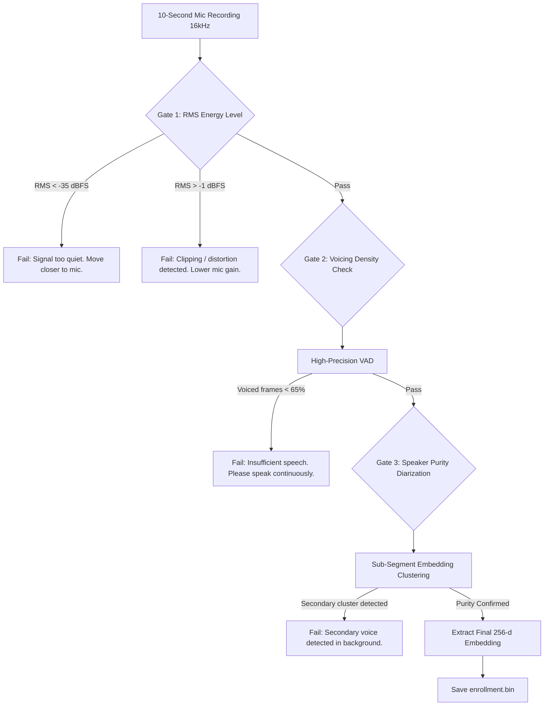

# 05. Enrollment Sanity-Check Engine

This document details the voice calibration workflow, sanity checks, and feature extraction pipeline used to generate the static speaker embedding $e \in \mathbb{R}^{256}$.

---

## 1. Why Enrollment Sanity Checks Are Critical

Target Speaker Extraction models depend directly on the conditioning vector $e$. If an enrollment recording is corrupted by:
- Background talkers (e.g., roommate speaking in the background during setup),
- Low input gain / clipping,
- Excessive background fan noise,

the resulting embedding will encode a blended acoustic profile. The network will either fail to extract the user's voice or erroneously preserve the secondary speaker.

---

## 2. Enrollment Multi-Stage Verification Pipeline

Before a 10-second enrollment recording is passed to the speaker encoder, it passes through three sequential gates:

---

## 3. The Three Verification Gates

### Gate 1: Energy & Dynamic Range Check
Computes Root-Mean-Square (RMS) and peak signal levels:

$$\text{RMS}_{\text{dBFS}} = 20 \log_{10}\left(\sqrt{\frac{1}{N} \sum_{n=1}^{N} x^2[n]}\right)$$

- **Reject if $\text{RMS} < -35\text{ dBFS}$:** Audio is too quiet; SNR will be inadequate for robust speaker vector extraction.
- **Reject if $\text{Peak} > -1.0\text{ dBFS}$:** The signal contains digital clipping, which creates harmonic distortion in the frequency domain.

### Gate 2: Voicing Density Check
A 10-second clip must contain active continuous speech, rather than 8 seconds of silence and 2 seconds of talking.
- Run a high-precision Voice Activity Detector (e.g., Silero VAD or WebRTC VAD) across 30ms frames.
- Calculate the active speech ratio:
  $$\rho_{\text{speech}} = \frac{N_{\text{voiced}}}{N_{\text{total}}}$$
- **Reject if $\rho_{\text{speech}} < 0.65$:** Require at least $6.5\text{ seconds}$ of active vocalized speech.

### Gate 3: Acoustic Purity & Co-Talker Detection
To prevent the user from enrolling while an interfering speaker is talking:
1. Divide the 10-second recording into five 2-second sub-segments: $s_1, s_2, s_3, s_4, s_5$.
2. Extract an embedding for each sub-segment using the frozen encoder: $e_1, e_2, \dots, e_5$.
3. Compute the pairwise cosine similarity matrix:
   $$S_{i, j} = \frac{e_i \cdot e_j}{\|e_i\|_2 \|e_j\|_2}$$
4. **Reject if $\min(S_{i, j}) < 0.75$:** A low minimum pairwise similarity indicates that distinct speakers or substantial non-stationary background noises dominated one or more sub-segments.

---

## 4. Frozen Embedding Generation

Once all gates pass:
1. Pass the full 10-second audio stream into the frozen **ECAPA-TDNN** model (or WeSpeaker ResNet34-LM).
2. The network outputs a 256-dimensional float vector:
   $$v \in \mathbb{R}^{256}$$
3. Normalize to unit hypersphere ($L_2$ norm):
   $$e = \frac{v}{\|v\|_2}$$
4. Serialize $e$ as a 1024-byte binary file (`enrollment.bin`, 256 IEEE 754 single-precision floats) stored locally in the user's application data directory.
