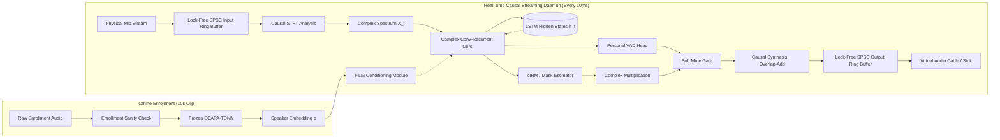
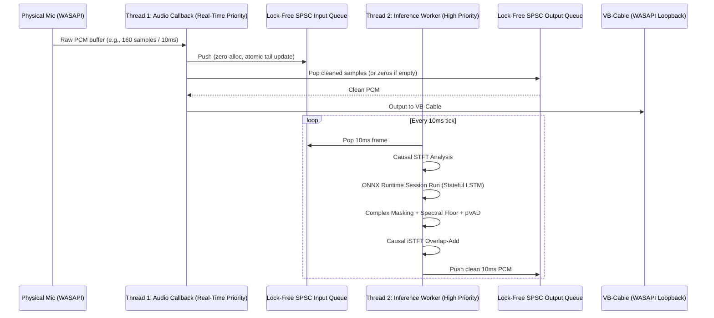
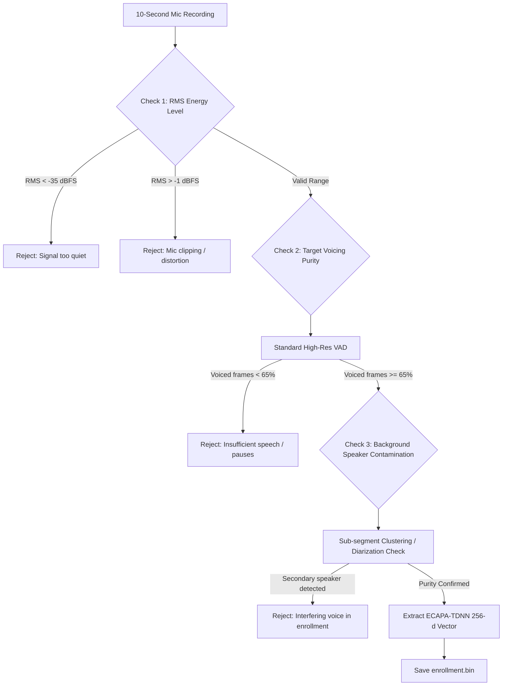

# Target Speaker Extraction (TSE) Real-Time Audio Daemon: Engineering Specification

## 1. Executive Summary & Problem Formulation

Standard acoustic noise suppression solutions (WebRTC NS, RNNoise, Krisp, RTX Voice) operate under a binary classification regime: **Speech vs. Non-Speech**. They suppress stationary noise (fans, HVAC) and non-stationary noise (keyboards, dogs), but preserve any vocal tract acoustic energy. 

In co-located or shared acoustic environments (dorms, call centers, open-plan offices, gaming LANs), secondary human speech penetrates standard noise suppressors. 

This system solves the **Cocktail Party Problem** in real time by conditioning an audio mask on a pre-computed target speaker embedding $e \in \mathbb{R}^{256}$ (d-vector). The system extracts the enrolled speaker's vocal acoustics while attenuating all interfering talkers, room reverberations, and environmental noise under a hard algorithmic latency budget ($\le 15\text{ ms}$).



---

## 2. Hard Constraints & Architectural Invariants

| Component | Architecture Decision | Justification |
| :--- | :--- | :--- |
| **Audio Format** | 16 kHz, 16-bit signed PCM, Mono | 16 kHz captures up to 8 kHz (Nyquist), covering all fundamental speech formants ($F_0$ to $F_4$). Operating at 48 kHz triples STFT bin dimensions and recurrent FLOPs with zero intelligibility gain. |
| **Speaker Encoder** | Pre-trained frozen ECAPA-TDNN / WeSpeaker ResNet34-LM | Training an encoder requires VoxCeleb (1,000s of hours) and metric learning losses (AAM-Softmax). Frozen zero-shot extraction eliminates runtime training overhead. |
| **Conditioning** | Zero-shot FiLM (Feature-wise Linear Modulation) | Eliminates per-user fine-tuning. Modulation requires only a single matrix multiplication at startup to derive scaling and bias vectors. |
| **Causality** | Strictly causal (no future frames, no lookahead) | Lookahead frames (e.g., $100\text{--}1000\text{ ms}$ in Demucs/AudioSep) make live communication impossible. Max permissible algorithmic lookahead is $0\text{ ms}$. |
| **Audio Virtualization** | User-space routing into VB-Audio Virtual Cable (Windows WASAPI loopback) | Kernel WDM/WASAPI driver development risks BSODs, requires Microsoft EV Code Signing, and adds months of driver verification overhead. |

---

## 3. Mathematical Pipeline: Time-Frequency Extraction

### 3.1 Causal Framing & Windowing
Given continuous discrete-time mic input $x[n]$ sampled at $f_s = 16{,}000\text{ Hz}$:
- **Frame Length ($N$):** 320 samples ($20\text{ ms}$) or 512 samples ($32\text{ ms}$).
- **Hop Size ($R$):** 160 samples ($10\text{ ms}$).
- **FFT Size ($K$):** 512 points (padded).
- **Analysis Window:** Causal asymmetric window or square-root Hann window applied strictly to past and current samples. Zero zero-padding into future samples is permitted.

For frame index $m$, the complex spectrogram frame $X(m, k) \in \mathbb{C}^{F}$ where $F = K/2 + 1 = 257$ frequency bins:

$$X(m, k) = X_r(m, k) + j X_i(m, k)$$

### 3.2 FiLM (Feature-wise Linear Modulation) Conditioning
Let $e \in \mathbb{R}^{D}$ ($D = 256$) be the normalized speaker embedding derived during enrollment. Let $H \in \mathbb{R}^{B \times C \times T \times F}$ be an intermediate feature representation in the network bottleneck.

The FiLM layer computes affine transformation parameters $\gamma, \beta \in \mathbb{R}^{C}$ via linear projections:

$$\gamma = W_\gamma e + b_\gamma, \quad \beta = W_\beta e + b_\beta$$

$$\text{FiLM}(H_{c}) = \gamma_c \cdot H_{c} + \beta_c$$

This forces the convolutional/recurrent feature extractors to selectively suppress activations corresponding to unconditioned spectral features.

### 3.3 Complex Ideal Ratio Masking (cIRM)
Rather than estimating only magnitude masks (which discards phase information and degrades speech naturalness), the network predicts a Complex Ratio Mask $M(m, k) = M_r(m, k) + j M_i(m, k)$:

$$\hat{S}(m, k) = X(m, k) \cdot M(m, k) = (X_r M_r - X_i M_i) + j (X_r M_i + X_i M_r)$$

To prevent floating-point mask blowups, bounded hyperbolic tangent masks are applied:

$$M_r = K_m \tanh(Y_r), \quad M_i = K_m \tanh(Y_i)$$

where $K_m$ is a scaling constant (typically 1.0 to 1.5).

### 3.4 Spectral Floor Clamping (Preventing Musical Noise)
Aggressive zero-forcing in spectral bins produces isolated spectral islands perceived as high-frequency musical chirps ("watery" artifacts). 

We enforce a minimum energy transmission floor $\alpha_{\min} \in [0.02, 0.05]$:

$$|M_{\text{clamped}}(m, k)| = \max(|M(m, k)|, \alpha_{\min})$$

---

## 4. Personal VAD (pVAD) & Anti-Hallucination Gate

When the enrolled speaker is silent, pure TSE networks risk non-linear bleed-through (amplifying faint secondary voices up to conversational levels). 

A parallel classification head branches off the recurrent bottleneck:

$$P(\text{Target Present} \mid X_t, e) = \sigma(W_{\text{vad}} H_t + b_{\text{vad}})$$

A soft-gain state machine prevents clicks:

$$g_t = \begin{cases} 
1.0 & \text{if } P(\text{target}) \ge \theta_{\text{on}} \\
0.0 & \text{if } P(\text{target}) \le \theta_{\text{off}} \\
\lambda g_{t-1} + (1-\lambda) \cdot 0 & \text{decay during hang-over}
\end{cases}$$

where $\theta_{\text{on}} = 0.6$, $\theta_{\text{off}} = 0.3$, and hangover time is set to $120\text{ ms}$ (12 frames) to preserve word endings and low-energy unvoiced consonants.

---

## 5. Synthetic Training & Emotional Speech Robustness

### 5.1 The "Gamer Scream" Distribution Shift
Academic models trained on LibriSpeech fail under emotional variance because shouting and screaming introduce:
1. Significant fundamental frequency shift ($F_0$ rises from $\sim 120\text{ Hz}$ to $>400\text{ Hz}$).
2. Formant dispersion and glottal leakage.
3. Severe mic clipping and non-linear proximity acoustic saturation.

```
Target Acoustic Corpus
├── Neutral Speech (LibriSpeech, VCTK) [40%]
├── Emotional Speech (ESD, CREMA-D: anger, excitement, whisper) [40%]
└── Shouting & Vocal Strain (DNS emotional partition) [20%]
```

### 5.2 Dynamic On-The-Fly Mixing Pipeline
Each training batch synthesizes an acoustic scene:
1. **Target Speaker ($S_t$):** Random 4-second chunk from speaker $A$.
2. **Interfering Speaker ($S_i$):** 1 to 2 random clips from speaker $B \neq A$. Signal-to-Interference Ratio (SIR) sampled uniformly from $\mathcal{U}(-5\text{ dB}, +15\text{ dB})$.
3. **Ambient Noise ($N$):** Point-source noise (fans, keyboard clicks, music) sampled from DEMAND or DNS-Challenge noise partitions at Signal-to-Noise Ratio (SNR) $\mathcal{U}(0\text{ dB}, 20\text{ dB})$.
4. **Spatial Simulation (RIRs):** Convolve $S_t$ with near-field direct RIR ($d < 0.5\text{ m}$); convolve $S_i$ with diffuse far-field RIR ($d \in [2.0\text{ m}, 5.0\text{ m}]$) to simulate roommate acoustics and proximity effects.
5. **Loss Function:** Joint Complex Spectral + SI-SDR Loss:

$$\mathcal{L} = \mathcal{L}_{\text{SI-SDR}}(s, \hat{s}) + \lambda_1 \left\| |S| - |\hat{S}| \right\|_{1} + \lambda_2 \left\| S - \hat{S} \right\|_{2}^2 + \lambda_3 \mathcal{L}_{\text{BCE}}(y_{\text{vad}}, \hat{y}_{\text{vad}})$$

---

## 6. Real-Time Deployment Architecture

### 6.1 ONNX Stateful Recurrent Export
PyTorch LSTMs maintain hidden state vectors $h \in \mathbb{R}^{L \times B \times D_{\text{hidden}}}$ and cell states $c \in \mathbb{R}^{L \times B \times D_{\text{hidden}}}$. In a streaming inference loop, recalculating from frame 0 is impossible.

When exporting to ONNX:
- Expose inputs: `stft_frame_real`, `stft_frame_imag`, `spk_embed`, `h_in`, `c_in`.
- Expose outputs: `out_mask_real`, `out_mask_imag`, `vad_prob`, `h_out`, `c_out`.
- The inference host passes `h_out` and `c_out` back into `h_in` and `c_in` for frame $t+1$.

### 6.2 Dual-Thread Lock-Free Audio Loop



### 6.3 Threading Rules (Anti-Glitch / Anti-Pop)
1. **Thread 1 (Audio Callback):**
   - Strictly `no_heap_allocations` (`malloc`, `free`, `new`).
   - Strictly `no_mutex_locks` (cannot block on OS synchronization primitives).
   - Strictly `no_disk_or_network_io`.
   - Ring buffers implemented via Single-Producer Single-Consumer (SPSC) circular arrays with atomic acquire-release fences.
2. **Thread 2 (Inference Worker):**
   - Batches frames if input queue exceeds 1 frame (adaptive catch-up to prevent queue overflow).
   - Executes ONNX Runtime with OpenMP threads locked to dedicated efficiency/performance cores.

---

## 7. Enrollment Sanity-Check Engine

A corrupted 10-second reference recording permanently breaks TSE conditioning. The enrollment workflow enforces three gating checks:



---

## 8. Development Phases & Milestones

### Phase 1: Python Mathematical Baseline & Verification
- Implement causal STFT/iSTFT framing with perfect reconstruction tests (SNR $> 80\text{ dB}$ on pass-through).
- Build frozen ECAPA-TDNN feature extraction module.
- Implement pDCCRN / VoiceFilter-Lite causal network in PyTorch with synthetic FiLM conditioning.
- Validate offline separation on Libri2Mix clips; measure SI-SDRi and PESQ.

### Phase 2: Domain Adaptation & Gaming Robustness
- Build data synthesis generator integrating ESD (emotional speech) and simulated room RIRs.
- Train pVAD head jointly with cIRM extraction.
- Apply dynamic SNR ranging ($-5\text{ dB}$ to $+15\text{ dB}$) and verify shrieking/whisper retention.

### Phase 3: Streaming ONNX Export & Runtime Profiling
- Export PyTorch model with recurrent hidden state inputs/outputs.
- Run ONNX Runtime verification against PyTorch output (ensure numeric difference $< 10^{-5}$).
- Benchmark inference latency per 10ms chunk across DirectML, TensorRT, and CPU INT8. Target: $< 2.5\text{ ms}$ wall-clock time per $10\text{ ms}$ stride.

### Phase 4: Native Desktop Engine (C++ / Rust)
- Implement SPSC circular buffer engine.
- Integrate audio I/O backend using WASAPI (miniaudio or cpal).
- Route stream into VB-Audio Virtual Cable.
- Conduct stress testing under 100% CPU/GPU loads to ensure zero buffer underruns (glitches/pops).

### Phase 5: Enrollment UX & System Tray Daemon
- Package a lightweight enrollment wizard with live visual feedback (metering, SNR check, purity gate).
- Minimize system tray daemon to run unobtrusively in background.
